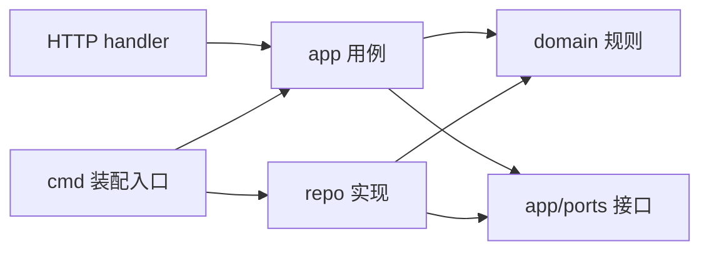

# PlanFlow 统一开发规范

版本：1.0。更新日期：2026-10-24。状态：后续开发的设计基线；工程配置和自动检查在 S0 落实，目前只交付文档。

本文统一命名、结构、接口、数据、交互和交付方式。适用于 Go API/worker、Next.js Web、迁移、测试和项目文档。PG/Redis 复用已有部署，当前不建设 CI/CD。阶段范围与排期见 [开发步骤](../plans/2026-10-24-planflow-development.md)，硬性产品与安全规则见 [AGENTS.md](../../AGENTS.md)。

## 1. 规则来源与使用方式

| 文档 | 负责回答 | 维护原则 |
|---|---|---|
| AGENTS.md | 哪些原则不可违反、Agent 如何工作 | 保存硬性边界并指向本文，不重复全文 |
| 产品方案/范围矩阵 | 做什么、哪些行为符合预期 | 产品语义的事实源；原文缺失时明确标记 |
| ADR | 为什么选择某个方案、有哪些代价 | 重大决定有编号、状态、影响与替代方案 |
| 本文 | 文件怎么放、代码/API/UI 如何保持一致 | 工程细则的统一入口 |
| OpenAPI | 每个已实施接口的字段、状态码、鉴权与示例 | HTTP 契约事实源，与实现同步修改 |
| 功能规格/验收记录 | 本次改什么、是否验证完成 | 使用统一模板，不把计划写成已完成 |

用户明确要求优先；本文不放宽 AGENTS.md 的产品、安全和范围限制。ADR 若改变现行规则，必须同时更新相关规范并说明兼容性，不能靠新增 ADR 留下互相矛盾的文档。实际代码与文档冲突时按 AGENTS.md 处理并同步修订，不隐瞒偏差。

“必须/禁止”为必守规则；“推荐”为默认做法，可在功能规格说明取舍；“待决”为依赖编码前必须确定的事项。例外按影响处理：普通局部选择记录在功能规格，跨模块契约/架构/权限/数据兼容变化记录 ADR。不增加逐项审批流程。

每次开发先读相关规范，使用 [功能规格模板](../templates/feature-spec.md) 明确本次范围，按阶段完成小闭环，再使用 [验收记录模板](../templates/verification.md) 记录真实结果。简单文案、格式或局部样式修改可在变更说明中简写，不强制创建完整功能规格。

## 2. 命名、格式与文件组织

### 2.1 命名表

| 对象 | 统一规则 | 示例 |
|---|---|---|
| 目录/TS 文件/文档 | 小写，单词用 `-` 分隔；Go 包除外 | `task-detail.tsx`、`feature-spec.md` |
| Go 包 | 简短小写，不加 `_`/`-`，按领域命名 | `task`、`today`、`auth` |
| Go 文件/测试 | `snake_case.go` / `_test.go` | `task_repository.go`、`dependencies_test.go` |
| Go 导出类型/函数 | PascalCase；缩写保持 Go 惯例 | `TaskID`、`CreateTask`、`HTTPClient` |
| Go 局部变量 | camelCase；不用无意义缩写 | `workspaceID`、`expectedVersion` |
| React 组件/类型 | PascalCase | `TaskDetail`、`TaskResponse` |
| TS 函数/变量/Hook | camelCase，Hook 以 use 开头 | `completeTask`、`useTaskList` |
| HTTP JSON/查询字段 | `snake_case` | `workspace_id`、`expected_version` |
| DB 表/列 | 复数表名、`snake_case` 列名 | `tasks`、`completed_at` |
| DB 索引/约束 | 前缀 + 表 + 关键列，显式命名 | `idx_tasks_project_status`、`uq_today_plan_items_plan_task` |
| 权限 action | 单数资源 + 动作，动作多词用 `_` | `task.update`、`task.change_status` |
| 业务事件 | 单数资源 + 已发生动作 | `task.created`、`task.status_changed` |
| 错误 code | 稳定的 `UPPER_SNAKE_CASE` | `TODAY_FULL`、`VALIDATION_FAILED` |
| i18n key | 按领域分组、语义命名 | `task.actions.complete`、`errors.todayFull` |
| 配置/环境变量 | 点分小写配置；`PLANFLOW_` 环境前缀 | `db.host` → `PLANFLOW_DB_HOST` |

索引名称须满足 PG 标识符长度限制，不能依赖截断获得唯一性。枚举值保持显式定义；默认状态使用 AGENTS.md 的四态，但可配置状态的终态语义不能只靠字符串判断。

所有文本使用 UTF-8、LF、文件末尾一个换行。Go 交给 gofmt/goimports；前端、JSON/YAML/Markdown 交给同一套 Prettier 配置。缩进等细节由 S0 的 `.editorconfig` 和 formatter 配置固定；`.gitattributes` 固定文本换行策略，避免 Windows 的 autocrlf 改回 CRLF，二进制不做文本转换。只格式化本次相关文件，已有文件的统一换行在 S0 明确安排。

不用 `common`、`utils`、`manager` 等目录堆放无关业务。确有通用能力时按用途命名；不因两个文件有相似几行就引入通用框架。注释说明约束和原因，避免重复代码含义。待办写 `TODO(decision): 问题及关联规格/ADR`，不能用待办代替必需实现。

### 2.2 目标目录

以下是按需形成的结构，未到对应阶段不创建空目录、空包和占位文件。

```text
services/api/
  cmd/{api,worker,migrate}/
  internal/
    domain/<领域>/                 # 纯实体、规则、领域错误
    app/<领域>/                    # 用例与编排
    app/ports/                     # 当前用例所需的仓储/事务等接口
    repo/models/                   # GORM 模型
    repo/                          # 仓储、事务、映射、数据库工厂
    transport/http/                # router、middleware、errors、DTO、handler
    auth/                          # 统一授权策略
    notify/                        # 事件与规则、渠道编排
    platform/                      # 配置、日志、Clock、ID、Redis、依赖装配
services/migrations/{pre,post}/
apps/web/
  app/                             # 路由、布局、页面状态；/screen 独立布局
  features/<领域>/                 # 业务组件、查询、变更和功能逻辑
  components/ui/                   # shadcn 基础组件
  components/shared/               # 已有多个领域复用的展示组合
  lib/api/                         # HTTP 客户端和共享契约类型
  lib/                             # 按职责命名的基础能力
  stores/                          # 必需的跨组件 UI 状态
  messages/zh-CN.json
docs/
  standards/                       # 工程规则
  decisions/                       # ADR
  product/                         # 产品方案和范围矩阵
  api/openapi.yaml                 # S0 建立，随当期接口逐步补充
  features/                        # 较完整的功能规格
  verification/                    # 实际验收记录及脱敏证据
  templates/                       # 可复制模板
  plans/                           # 阶段执行计划
```

storage/secrets 只在 P1 相应阶段增加；其他未来功能亦如此。根目录保留一个 Go module；pnpm workspace 和工具版本在 S0 锁定，不另建第二套同名 Go module。

## 3. 分层、接口与用例约束



| 层 | 必须承担 | 禁止承担 |
|---|---|---|
| domain | 不变式、状态语义、依赖检查、领域错误 | Gin/GORM/S3、网络调用、读取全局配置 |
| app | 授权、事务边界、用例编排、Activity、可靠事件交接 | Gin 上下文、具体仓储构造、GORM 句柄 |
| ports | 当前消费者所需的最小接口，参数为领域/应用类型 | SDK 类型、无用途的泛型 CRUD 仓储 |
| repo | GORM/SQL、安全查询、映射、事务实现、错误归一 | 替 handler 作响应、调用通知渠道 |
| HTTP | 绑定、输入校验、调用 app、DTO 映射、集中错误处理 | 手写角色分支、SQL、容量/状态流等业务规则 |
| Web | 展示、交互、输入反馈、缓存协调 | 取代服务端授权/校验、直连数据库或 RustFS |

接口定义在消费者所属的 app/domain；repo 实现接口，cmd 负责注入。app 不直接 import repo 来初始化仓储。共享 ports 只放确实被多个用例/实现使用的契约，避免一个巨型接口迫使所有领域相互依赖。

Go 用例使用 `context.Context` 作为第一个参数、`error` 作为最后一个结果；使用命名入参结构体避免多个易混字符串参数。请求 DTO、用例入参、domain 实体和 GORM 模型各自负责一层，显式映射；这不是允许为 Inbox/Today 复制另一套任务模型。

业务写入的统一顺序：校验入参 → 识别 actor/资源作用域 → `auth.Authorize` → 事务内读取与必要的重新校验/锁定 → 领域规则 → 带版本条件的写入 → Activity → 必要的持久化事件 → 提交 → 响应。易受并发影响的授权/资源状态要在事务中重新保证，不能只信事务前读到的结果。

Unit of Work 在 repo 内打开事务，向 app 回调提供绑定同一事务的仓储；回调失败全部回滚。Activity 失败不能吞掉；事务回调内不发送邮件、不调用外部 HTTP/S3、不自行启动无托管 goroutine，也不嵌套开启仓储事务。只读请求不为形式统一而开启写事务。

错误用 `errors.Is/As` 和 `%w` 保留原因；不能按错误字符串匹配，也不把 SQL/SDK 详情透传。处理错误的边界负责必要日志，避免每层重复记同一个错误。禁止忽略 error 或通过 panic 处理正常业务失败。

## 4. HTTP/API 契约

### 4.1 路由与请求

- 业务 API 统一前缀 `/api/v1`；工作区资源默认位于 `/api/v1/workspaces/{workspace_id}/...`。认证位于 `/api/v1/auth/...`，大屏读取位于 `/api/v1/screen/...`；`/healthz`、`/readyz` 保持独立。这里是命名约定，不提前注册未来路由。
- 集合用复数名词；`GET` 查询、`POST` 创建、`PATCH` 部分更新、`DELETE` 软删除；特殊操作使用有业务含义的 POST 子资源，如 `.../tasks/{task_id}/complete`，在 OpenAPI 写明 action 和审计点。禁止有业务副作用的 GET。
- JSON 字段使用 snake_case，`Content-Type: application/json`；拒绝无效 JSON、未知写入字段和不合法枚举，设置请求体大小上限。路由、query、body 都是外部输入。
- actor 从认证上下文取，不接受客户端传入的 `actor_id`/角色。资源按实际工作区授权，body 中的项目/任务 ID 也必须校验所属范围。
- PATCH：字段缺失表示保持原值；`null` 仅允许清空已声明可空字段；空字符串与 null 不混用。不能用普通零值绑定丢掉“未提供”与“显式置零”的区别。
- API 的 ID 一律为不透明字符串，前端不解析内部结构或转成 JS number。内部 ID 算法在 S0 确定后统一，不在各模块各选一种。
- 时间点传 RFC 3339 的 UTC `Z` 字符串；本地计划日期传 `YYYY-MM-DD`；时区为 IANA 名称。禁止由浏览器当前时区替代工作区时区，禁止硬编码 `+08:00` 计算业务日期。

### 4.2 成功、分页与错误

单资源成功响应直接返回该资源 DTO；集合使用 `items + pagination`；不额外套 `success/code/data`。普通创建返回 201，更新/动作返回 200 与更新后的资源，删除成功返回 204 无响应体；确实异步受理才使用 202 并提供可查询状态。204 和 SSE 不套 JSON 包装。

MVP 列表统一使用 offset 分页：`limit` 默认 20、范围 1–100，`offset` 默认 0 且非负；非法值返回 400。资源确定稳定默认排序并增加 ID 作为同值次序，允许排序字段走白名单。`has_more` 从多取一条得出，不强制每次全量 COUNT。并发更新下 offset 不是快照，实时列表变更后刷新；不能宣称跨页绝不重复/遗漏。需要 cursor 时单独记录契约变更。

集合空结果为 `items: []`，不返回 null。分页结构固定如下，示例不是已实现接口：

```json
{
  "items": [],
  "pagination": { "limit": 20, "offset": 0, "has_more": false }
}
```

错误沿用 AGENTS.md 的唯一结构，`details` 无内容时仍是 `{}`。`message` 是安全的兜底说明，前端按 code 映射 i18n，不依赖 message 做判断。字段错误使用 `details.field_errors`，键为请求字段路径、值为稳定规则标识；不得回显密码等原始输入。

```json
{
  "code": "VALIDATION_FAILED",
  "message": "Request validation failed",
  "details": { "field_errors": { "title": "required" } }
}
```

| HTTP | 统一 code/语义 |
|---|---|
| 400 | VALIDATION_FAILED：格式、字段或规则入参不合法 |
| 401 | UNAUTHORIZED：身份无效；P1 敏感二次认证使用 REAUTH_REQUIRED |
| 403 | FORBIDDEN：已认证但无权限 |
| 404 | NOT_FOUND：资源不存在；隐藏不可见资源时采用同一策略 |
| 405 | METHOD_NOT_ALLOWED：已知路由不支持该方法，包括大屏写方法 |
| 409 | CONFLICT、TODAY_FULL、DEPENDENCY_CYCLE：需业务处理的冲突 |
| 429 | RATE_LIMITED：限流，附适当 Retry-After |
| 500 | INTERNAL_ERROR：安全兜底，不返回堆栈或底层异常 |
| 503 | SERVICE_UNAVAILABLE；P1 存储失败使用 STORAGE_UNAVAILABLE |

所有错误（含绑定失败、认证、中间件、无路由/方法）集中映射，不让 Gin 默认文本响应混入 API。请求/响应传递受校验的 `X-Request-ID`，方便关联日志；生产环境的内部错误以 request ID 定位，前端不展示内部异常。

### 4.3 版本、幂等与兼容

可并发修改的资源返回 `version`，更新/动作提交 `expected_version`，事务内比较并原子递增；版本不匹配为 409 CONFLICT。不能靠前端最后一次读取或先查后写解决覆盖。删除/恢复等动作是否要求版本在各资源契约明确，禁止实现中临时省略。

优先使用业务唯一键保证幂等，例如计划项引用、重复任务 occurrence、通知接收人维度。对没有天然唯一键且允许安全重试的创建/批量命令，规格需明确 `Idempotency-Key`、作用域、请求摘要、保留期及重复/冲突响应，再实现存储；不自动为所有接口增加一套幂等框架。HTTP 客户端不得默认重试无幂等保障的写操作。

OpenAPI 统一维护在 `docs/api/openapi.yaml`，采用 3.0.3；每个接口写明鉴权、action、参数、缺失/null 语义、状态码、分页、冲突、幂等和安全头。该文件只在 S0 开始契约建设时创建，不为 P1 提前生成占位接口。前端使用由同一契约产生/校对的共享类型；生成工具先评估，禁止手工改生成文件或为了规范引入额外运行时框架。

已有客户端依赖的字段不能随意删除/重命名/改含义；可空性、枚举、排序、权限收紧也是兼容性变化。新增字段也要评估客户端解析；新枚举的前端需有安全降级。用 API 版本/分步兼容迁移处理破坏性变化，不另加 `/v1-new` 等临时接口。

## 5. 模型、数据库与迁移

- Task 是任务事实源；TodayPlanItem 只保存引用、排序与时间块，查询可引用共享 TaskResponse，不定义另一套 InboxTask/TodayTask DTO。大屏使用最小只读投影，不复制业务写模型。
- 共享业务实体明确 workspace_id，所有仓储查询/更新以作用域约束；用户归属、项目归属、跨工作区 FK/应用校验共同防止错误引用。不能用客户端传来的 workspace_id 直接替代资源授权。
- 通用业务字段按需要使用 `id/created_at/updated_at/deleted_at/version`，显式映射类型和 TableName；不把一个大 BaseModel 强塞给审计、关系或幂等记录。append-only 审计不走软删除，临时投递数据按独立生命周期管理。
- 时间点使用 timestamptz 并写 UTC；计划日期使用 date。所有业务时间从 Clock 取；默认值、worker 调度和查询边界保持同一时间语义。
- 索引根据查询模式显式声明并考虑 workspace 前缀；唯一键覆盖并发不变式。软删除唯一性在真实 PG 中验证，必要时用部分唯一索引；不能假设 nullable deleted_at 联合唯一键能约束未删除记录。
- 更新显式列出允许写入字段，零值更新要有测试；禁止把请求直接 `Save` 到模型。动态筛选/排序走映射白名单，列表关联按需要 Preload，防止 N+1 和全表扫描。
- 删除/恢复要逐项定义父子任务、依赖、评论、今日引用的行为；不默认级联永久删除。Unscoped 仅出现在已授权回收站仓储路径。
- 迁移遵守 ADR 0001：加锁 → pre SQL → AutoMigrate → post SQL → P1 ensure bucket → 解锁；SQL 命名 `NNNN_verb_subject.sql`，编号全局唯一，阶段和 checksum 入记录。没有 SQL 需求就不造空迁移。
- pre/post 各自排序，不因全局编号假定交错执行；同一文件只放同一阶段可安全执行的操作。新库上的 pre 必须处理旧表不存在；已成功文件不修改，新变更另加版本。
- 不可逆和非事务 SQL 在文件头声明原因/执行要求；大表分步回填、约束和并发索引有进度及恢复策略。迁移不是整体原子事务，失败后识别已成功步骤；不能只靠应用回退撤销 schema 变化。

## 6. 权限、Activity、事件与配置

所有业务读取/写入通过 `auth.Authorize`，策略默认拒绝；handler 不写 `role == ADMIN` 分支。UI 可据服务端能力提示隐藏入口，但隐藏按钮不构成权限控制。未知资源类型、未知 action、跨工作区资源一律拒绝；失权要覆盖普通请求、缓存和 SSE。

Activity 与业务写入同事务，只写 actor、action、resource、request ID 和白名单 before/after 摘要；不得序列化完整请求或整个实体。无业务变更的幂等重放不重复制造业务审计；失败尝试按安全审计需求另行处理，不伪装成成功 Activity。

通知只能经 notify.Emit 入口，事件标识、资源、actor、时间和 schema 版本有稳定定义；payload 最小化，不复制完整任务/评论和敏感信息。业务事务与事件可靠交接按 S2 ADR 落地，消费按至少一次设计，以接收人和业务周期等唯一键去重。重试次数、退避、死信和人工恢复有边界；SSE 只是刷新提示，断线后仍可从授权数据源补拉。

Config 只加载一次并强类型校验。配置字段与 PLANFLOW 环境映射保持一对一；超时、容量、重试窗口等具有业务/运维意义的参数明确单位和范围，避免散落魔法值。MVP 不要求尚未启用的 P1 配置。示例不包含真实密钥，启动失败只给安全的字段缺失说明，不打印整份配置。

日志统一 Zap JSON，字段 snake_case，带 request/user/workspace 的必要标识；默认不记录 body/query。请求取消向数据库和外部调用传播；依赖调用设超时，后台任务也使用可取消的 worker context。错误日志和审计各负其责，不把 token、密码、对象 key、URL、Cookie 或文件内容写进去。

开发、测试、实际使用环境分别配置 PG/Redis；测试入口先验证隔离目标，绝不自动兜底连接开发库。独立 Redis DB 编号不能代替 ACL/实例隔离；禁止清理共用实例。没有 CI/CD 也必须能手动复现验证，不引入新的部署平台作为前置。

## 7. 前端代码与交互一致性

### 7.1 数据与状态

- 默认 Server Component，交互 client 边界下沉；route/page 做组装，业务放 features，底层请求放 lib/api。Next.js 代理如用于同源/认证转发，不重复编写一套业务 API。
- TypeScript 开启 strict，禁止用 any、双重断言和随意 ts-ignore 掩盖契约问题。外部输入从 unknown 做边界校验；编译期类型不能当作运行时验证。
- HTTP JSON 和共享契约保留 snake_case；React props、局部状态使用 camelCase。不全量复制 Task 成另一套前端实体，展示格式由 formatter/组件计算；GORM/domain 类型不直接输出给浏览器。
- TanStack Query 管服务端数据，Zustand 只存确需跨组件共享的 UI 状态；组件内临时状态就地管理。表单状态不是已保存数据，URL 仅存可分享的非敏感筛选/页码。
- Query key 至少包含资源、workspace、有效身份作用域及筛选/分页，详情包含 ID；例如 `["tasks", { workspaceId, userId, filters, offset, limit }]`。换用户/工作区取消旧请求并清理旧缓存；Server Component fetch 显式设置用户数据缓存策略，不能跨用户共享。
- Task 变更后统一失效详情、列表、今日、日历及有关指标，不让各页面各写一套完成逻辑。乐观更新必须能回滚；版本冲突、越权与容量确认默认等待服务端结果，保留用户输入并提示后续动作。
- API 客户端统一解析成功/错误、request ID、超时和取消；禁止每个组件直接拼 URL 或解析错误 message。取消请求不显示“操作失败”；鉴权过期走统一恢复/登录流程。

### 7.2 组件与视觉基线

| 类别 | 统一要求 |
|---|---|
| 基础组件 | 优先复用 shadcn/ui；Button/Input/Dialog/Select 等只有一个基础实现 |
| 业务组合 | 多处用到的 Task 状态、优先级、头像、日期、空状态复用组件；不为单次使用提前抽象 |
| 样式 | 颜色、间距、圆角、阴影、字号使用 Tailwind/CSS 语义 token；同一语义不在页面各设一套值 |
| 间距/文字 | 默认基于 4px 间距尺度；常规正文 14/16px，辅助信息 12px，页面层级统一；最终 token 在首个真实页面确认 |
| 颜色 | background/foreground、primary、muted、destructive 等语义化；状态同时有文字/图标，不只靠颜色 |
| 页面结构 | 统一标题/主要操作/筛选/内容区位置；看板/列表共用筛选和任务操作；大屏保持独立只读布局 |
| 表单 | 可见 label、必填说明、字段级错误；服务端校验仍生效，错误时保留输入并聚焦首个错误 |
| 动作反馈 | 提交期间 loading/禁用重复操作；成功反馈明确，错误可重试；toast 不替代字段错误或关键确认 |
| 破坏性动作 | 二次确认说明对象与影响；今日越限/顺延使用对应业务确认，不复用含糊的“确定继续” |
| 可访问性 | 键盘可操作、焦点可见、Dialog 焦点管理、图标按钮有名称；常规文本对比度至少 4.5:1 |
| 响应式 | 在 360/768/1440px 代表宽度验证，无非预期整页横向溢出；看板等横向内容在局部容器滚动 |

页面必须区分首次加载、真正空数据、筛选无结果、局部刷新失败和提交失败；不能所有状态都显示空白或“暂无数据”。保留已有数据刷新时不清屏。交互支持触控与键盘，不能把拖拽作为唯一操作方式。

所有可见文案（包括 aria-label、toast、错误、空状态）走 i18n。日期/数字按当前语言格式化，业务日期按工作区时区；服务端返回稳定 code，中文表达统一在 messages。敏感响应遵守 no-store 和禁持久缓存要求，P1 实现时不能复用普通 Query 缓存。

## 8. 测试、质量与本地交付

| 改动 | 最小有意义的验证 |
|---|---|
| 领域规则 | 表驱动单测，覆盖边界/非法状态，时区用 Clock |
| 仓储/事务/索引 | 真实 PG 集成测试，覆盖回滚、隔离、并发和唯一约束 |
| API/权限 | 绑定校验、统一错误、401/403/404、角色/资源范围、无路由/方法响应 |
| UI 业务交互 | 可见行为、失败/重试、冲突/重复提交；复杂交互补组件测试 |
| 主闭环 | Playwright，至少覆盖当前阶段的实际用户路径 |
| 配置/迁移 | 缺失/非法配置、空库/升级/重复执行/失败恢复 |
| 文档/简单样式 | 链接、示例一致性、格式和必要人工视觉检查，不为低风险修改造镜像测试 |

修 bug 先加能复现的失败用例；不测试私有函数调用次数等实现细节。单元测试无外部服务依赖，集成测试显式启用独立配置，测试目录/命名能区分二者；外部邮件等渠道可用替身，不用 mock 掩盖 SQL 或事务问题。测试数据每次隔离，不依赖全局固定账号和历史数据；不使用真实密码或业务内容作为 fixture。

S0 交付单一命令入口，Windows PowerShell 逐条运行并检查退出码：`make fmt`（主动格式化）、`make lint`、`make test`、`make build`、`make 'test:integration'`、`make 'test:e2e'`。fmt 不纳入只读验收；阶段末运行全部适用检查，改动中按受影响范围快速验证。S0 前命令只是交付约定，不能把不存在的脚本记作成功。

验收状态只使用：通过、失败、阻塞、未执行、不适用（带理由）。未执行不等于通过；阻塞项记录解除条件，不偷偷跳过。无 CI/CD 时记录本机版本、命令/退出码、环境标识、功能检查、脱敏截图、迁移/权限/通知影响和回退方式；不要求粘贴可能含敏感数据的完整日志。

提交使用 `feat|fix|refactor|docs|test|chore(scope): summary`，分支默认 `codex/<topic>`；一个变更聚焦一件事。新增依赖先检查等价能力，在说明里写用途/替代方案及是否运行时依赖，锁定版本。不提交 .env、配置密钥、生成的构建产物和测试数据目录。代码生成物是否入库在生成方案中固定，禁止混用手写和生成版本。

涉及 schema 记录表/列/索引/约束和 SQL 阶段；涉及权限记录 action 和范围；涉及通知记录事件/接收人/幂等；涉及 UI 附实际截图。没有 PR 平台时写入同样的变更/验收说明，不为格式完整而建立外部系统。

## 9. 从下一次开发开始如何执行

1. 明确阶段与本次范围，阅读 AGENTS、本规范和相关 ADR；产品决策未定时标记具体依赖，继续独立事项。
2. 从 [功能规格模板](../templates/feature-spec.md) 写清契约、权限、数据、并发/幂等、界面状态及验收；简单变更可简写。
3. 先定义可验收规则与失败用例；涉及模型按 AGENTS 的模型/迁移顺序推进，完成一个小闭环再做下一个。
4. 接口变化同步 OpenAPI 和共享类型，配置变化同步 Validate/示例，规则变化同步 ADR/规范，不另存私有约定。
5. 运行适用的本地检查，使用 [验收模板](../templates/verification.md) 如实记录；完成阶段 Gate 后再进入下一阶段。

S0 需落实的工程配置：formatter/editorconfig/gitattributes、Go/Node/pnpm/tool 版本锁定、TS strict、lint、OpenAPI 校验/类型同步方式、独立测试配置和命令入口。这些在一个实际脚手架变更中实施；当前不创建无应用可检查的空配置，也不开始业务开发。

尚需按阶段确定：认证及 Cookie/SSE 拓扑、ID 算法、项目角色覆盖、今日超限协议、状态流配置、可靠事件实现、大屏 token 分发、P1 文件访问与加密细节。它们的表达必须遵守本文，但本文不冒充产品结论；详情见开发步骤中的 ADR 清单。
